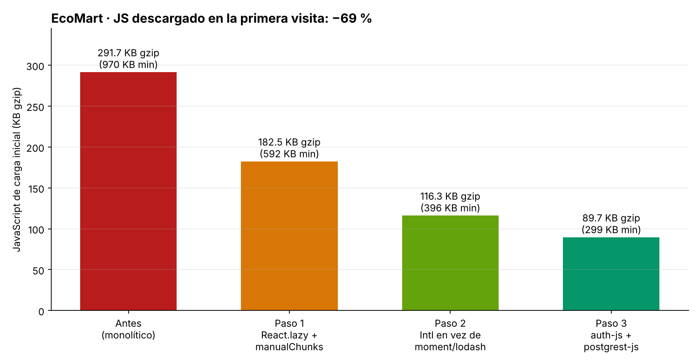

# 🛒 EcoMart · Auditoría de IA y Optimización Final

Proyecto Integrador **"Auditoría de IA y Optimización Final"**.
E-commerce sostenible en **React 18 + Vite 5 + TypeScript (strict) + Tailwind CSS + Supabase**, auditado con IA antes del salto a producción.

| Resultado | |
|---|---|
| 🔐 Seguridad | 3 hallazgos críticos + 9 adicionales corregidos · **7/7 ataques reales bloqueados** |
| ⚡ Rendimiento | JS de carga inicial **291,7 → 89,7 KB gzip (−69 %)** |
| 🧱 Hardening | service_role fuera del cliente, verificada en build y en runtime |



## 📦 Entregables

| Entregable | Ubicación |
|---|---|
| **Informe de auditoría** (3 hallazgos críticos, diálogo iterativo con la IA, correcciones) | [`docs/INFORME_AUDITORIA.md`](docs/INFORME_AUDITORIA.md) |
| **Reporte de optimización** (antes/después, `vite.config.ts`, rutas lazy) | [`docs/REPORTE_BUNDLE.md`](docs/REPORTE_BUNDLE.md) |
| **Código mejorado** (formulario de registro) | [`src/pages/RegisterPage.tsx`](src/pages/RegisterPage.tsx) vs. [`audit/antes/RegisterForm.before.tsx`](audit/antes/RegisterForm.before.tsx) |
| **Política RLS refactorizada** | [`supabase/migrations/20261030_001_hardened_schema.sql`](supabase/migrations/20261030_001_hardened_schema.sql) vs. [`audit/antes/rls.before.sql`](audit/antes/rls.before.sql) |
| Evidencia de los ataques (antes/después) | [`docs/rls-test-results.txt`](docs/rls-test-results.txt) |
| Treemaps del bundle | [`docs/bundle/`](docs/bundle) |
| Capturas de la app | [`docs/capturas/`](docs/capturas) |

## 🗂️ Estructura del repositorio

```
ecomart/
├── audit/antes/                    # Código ORIGINAL vulnerable/pesado (referencia de la auditoría)
│   ├── RegisterForm.before.tsx     #   XSS, contraseña en localStorage, open redirect…
│   ├── rls.before.sql              #   Políticas RLS permisivas
│   ├── supabase.before.ts          #   service_role expuesta
│   ├── Checkout.before.ts          #   Precio decidido por el cliente
│   ├── App.before.tsx              #   Rutas sin code splitting
│   ├── format.before.ts            #   moment + lodash
│   └── vite.config.before.ts
├── docs/
│   ├── INFORME_AUDITORIA.md        # Informe principal
│   ├── REPORTE_BUNDLE.md           # Reporte de optimización
│   ├── rls-test-results.txt        # Salida de los ataques SQL
│   ├── bundle/                     # Treemaps (html + png), gráfico y datos JSON
│   └── capturas/                   # Capturas de la app
├── supabase/
│   ├── migrations/                 # Esquema endurecido: RLS, grants, RPCs, trigger
│   └── tests/                      # Stub de Supabase, seeds y ataques SQL
├── scripts/
│   ├── check-secrets.mjs           # Bloquea el build si hay claves privilegiadas
│   └── run-rls-tests.sh            # Ejecuta los ataques contra Postgres (antes y después)
├── src/
│   ├── pages/                      # Rutas (todas lazy salvo Home)
│   ├── components/                 # Layout, ProtectedRoute, RouteErrorBoundary, PageLoader…
│   ├── context/                    # AuthContext, CartContext
│   ├── lib/
│   │   ├── supabase.ts             # Cliente mínimo (auth-js + postgrest-js) + assertPublicKey
│   │   ├── api.ts                  # Capa de datos: columnas explícitas, RPCs
│   │   ├── security.ts             # safeRedirect, política de contraseñas, limpieza de texto
│   │   ├── sanitize.ts             # DOMPurify con lista blanca (solo en la ruta de producto)
│   │   ├── format.ts               # Intl nativo (reemplaza moment/lodash)
│   │   └── lazyWithPreload.ts      # React.lazy + precarga al pasar el mouse
│   ├── routes.ts                   # Definición de rutas lazy
│   └── App.tsx                     # Router + Suspense + ErrorBoundary
├── public/_headers                 # Cabeceras de seguridad (Netlify/Cloudflare)
├── vercel.json                     # Cabeceras de seguridad (Vercel)
├── vite.config.ts                  # manualChunks, visualizer, drop console
└── .env.example                    # Variables públicas vs. secretos
```

## 🚀 Cómo ejecutarlo

```bash
npm install
npm run dev               # http://localhost:5173 (modo demo con datos simulados)
```

En modo demo, ingresa con cualquier correo y una contraseña de 6+ caracteres. Usa `admin@ecomart.demo` para ver el panel de administración.

### Conectar a Supabase

1. Ejecuta `supabase/migrations/20261030_001_hardened_schema.sql` en el SQL Editor.
2. Copia `.env.example` a `.env.local` con `VITE_SUPABASE_URL` y `VITE_SUPABASE_ANON_KEY` (**nunca** la service_role).
3. Asigna el primer admin desde el dashboard: `update profiles set role = 'admin' where id = '<uuid>';`

### Comandos

```bash
npm run build             # typecheck + build + check-secrets
npm run build:analyze     # genera stats.html (rollup-plugin-visualizer)
npm run check:secrets     # escanea src/, dist/ y .env* buscando claves privilegiadas
./scripts/run-rls-tests.sh  # ataques SQL antes/después (requiere PostgreSQL 15+ local)
```

## 🔐 Variables de entorno

| Variable | ¿Pública? | Dónde vive |
|---|---|---|
| `VITE_SUPABASE_URL` | Sí | Frontend |
| `VITE_SUPABASE_ANON_KEY` | Sí (la seguridad la imponen las RLS) | Frontend |
| `SUPABASE_SERVICE_ROLE_KEY` | **No — salta RLS** | Solo Edge Functions o servidor. **Nunca** con prefijo `VITE_` |

Vite solo expone al navegador variables con prefijo `VITE_`. Hay tres barreras: `check-secrets.mjs` (build/CI), `assertPublicKey()` (runtime) y la documentación en `.env.example`.
