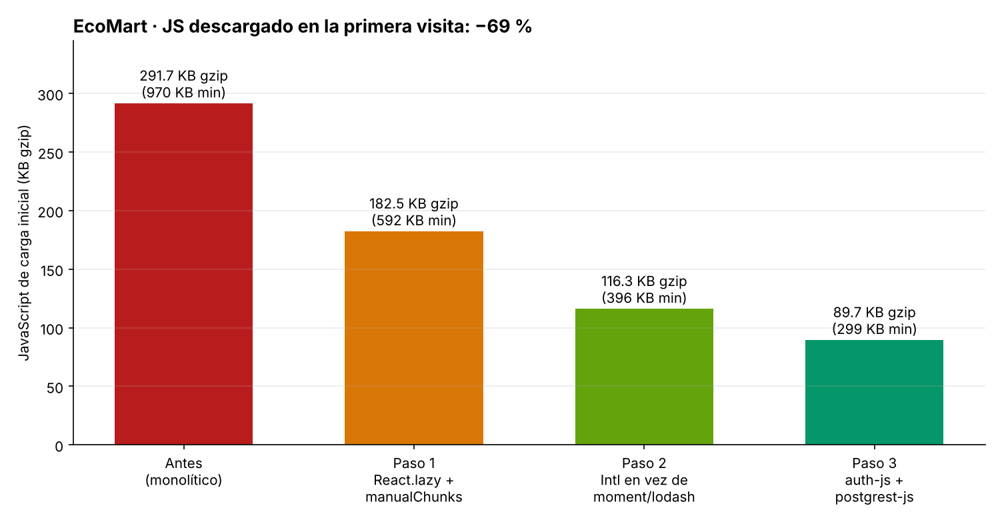

# Informe de Auditoría de IA y Optimización Final · EcoMart

| | |
|---|---|
| **Proyecto** | EcoMart — e-commerce sostenible (React 18 + Vite 5 + TypeScript + Supabase) |
| **Alcance** | Frontend (formularios, auth, carrito, rutas), políticas RLS y funciones de Supabase, configuración de build y variables de entorno |
| **Metodología** | Arquitectura basada en especificaciones + revisión estática asistida por IA + verificación con pruebas reales (ataques ejecutados contra PostgreSQL y medición del bundle) |
| **Fecha** | 30 de octubre de 2026 |
| **Resultado** | 3 hallazgos críticos y 9 adicionales corregidos · 7/7 ataques bloqueados · JS inicial −69 % (291,7 → 89,7 KB gzip) |

---

## 1. Resumen ejecutivo

La auditoría encontró que **EcoMart no estaba listo para producción**: cualquier visitante podía extraer la clave maestra de la base de datos desde el navegador, cualquier usuario registrado podía convertirse en administrador, ver los datos personales de todos los clientes y comprar productos al precio que quisiera. Además, la primera visita descargaba **970 KB de JavaScript** (292 KB comprimidos) en un solo archivo, incluido el panel de administración que solo usan dos personas.

Tras el ciclo de auditoría:

- La **service_role key** se eliminó del cliente y un script bloquea el build si vuelve a aparecer.
- Las **políticas RLS** se reescribieron con enfoque *deny-by-default*. Se ejecutaron 7 ataques reales contra el esquema anterior (6 exitosos) y contra el nuevo (**0 exitosos**), y 7 flujos legítimos siguen funcionando.
- El **precio y el estado de los pedidos** ahora los decide la base de datos mediante la función `create_order`, no el navegador.
- El **JavaScript inicial bajó 69 %** gracias a `React.lazy` + `Suspense`, eliminación de moment/lodash y un cliente de Supabase más liviano.

---

## 2. Proceso: diálogo iterativo con la IA

La auditoría no se hizo con un único prompt. Se siguió un ciclo **especificar → analizar → verificar → refinar**, tratando la respuesta de la IA como una hipótesis que debe demostrarse con pruebas.

### Iteración 1 · Prompt sugerido (línea base)

> Actúa como un experto en ciberseguridad. Analiza el siguiente código React y las políticas RLS de Supabase en busca de vulnerabilidades (XSS, Inyección, fallos de autenticación). Propón correcciones específicas.
>
> *[Se adjuntaron `RegisterForm.before.tsx` y `rls.before.sql`]*

**Respuesta de la IA (resumen):** detectó el XSS por `dangerouslySetInnerHTML`, el `console.log` de la contraseña y la política `using (true)` en `profiles`. Propuso "usar validación de inputs" y "revisar las políticas".

**Análisis crítico:** correcto pero superficial. No detectó la escalada de privilegios por la columna `role`, ni el problema de lógica de negocio del checkout, ni la clave `service_role` (porque no se la mostré). Las correcciones eran genéricas.

### Iteración 2 · Prompt avanzado con modelo de amenazas

> **Rol:** Eres un auditor de seguridad de aplicaciones especializado en Supabase/PostgreSQL y React (OWASP ASVS nivel 2).
>
> **Contexto del sistema:** e-commerce con Supabase. El navegador habla directamente con PostgREST usando el JWT del usuario. Roles: `anon`, `authenticated`. Existe un rol de negocio `admin` guardado en `profiles.role`. Adjunto: (1) cliente Supabase, (2) formulario de registro, (3) función de checkout, (4) todas las políticas RLS y funciones SQL, (5) `vite.config.ts` y `.env.example`.
>
> **Modelo de amenazas:** asume que el atacante (a) tiene DevTools y puede modificar cualquier JS, localStorage o petición HTTP, (b) puede crear una cuenta, (c) conoce la URL del proyecto y la anon key, que son públicas.
>
> **Tarea:** para cada vulnerabilidad entrega: ID, categoría OWASP, severidad (CVSS 3.1 aproximado), archivo y línea, **pasos concretos de explotación**, impacto y la corrección en código/SQL. Revisa especialmente: escalada horizontal y vertical en RLS, columnas actualizables, funciones `SECURITY DEFINER`, valores de negocio controlados por el cliente y secretos en variables `VITE_`. Ordena por severidad y no incluyas recomendaciones genéricas sin evidencia.

**Respuesta de la IA:** 12 hallazgos con pasos de explotación. Aparecieron los tres críticos (service_role, escalada de rol, precio desde el cliente) y otros que la iteración 1 no vio: `SECURITY DEFINER` sin `search_path`, open redirect, enumeración de usuarios y rol aceptado desde `user_metadata`.

**Lo que aprendí:** definir **el modelo de amenazas** ("el atacante controla todo el navegador") fue lo que cambió la calidad de la respuesta. Sin él, la IA asume que el cliente es confiable.

### Iteración 3 · Verificación: "demuéstralo"

> Para cada hallazgo de severidad Alta o Crítica en las RLS, escribe una prueba SQL que se ejecute como el rol `anon` o `authenticated` (simulando `auth.uid()` con `request.jwt.claim.sub`) y que **tenga éxito contra el esquema actual**. Después escribe la migración corregida y verifica que las mismas pruebas fallen, y que los flujos legítimos (ver catálogo, crear pedido, editar nombre, admin ve ventas) sigan funcionando.

**Resultado:** se construyó `scripts/run-rls-tests.sh`, que levanta un PostgreSQL temporal con los roles y privilegios por defecto de Supabase y ejecuta los ataques contra ambos esquemas.

**La verificación encontró un error en la primera corrección:** la nueva política de productos (`is_active or is_admin()`) **bloqueaba el catálogo a los visitantes anónimos**, porque `anon` no tiene permiso para ejecutar `is_admin()`. Una revisión solo con IA lo habría dejado pasar. Se corrigió separando la política por rol (`products_read_active_anon` y `products_read_authenticated`) en vez de conceder `EXECUTE` a `anon`.

### Iteración 4 · Rendimiento

> Este es el reporte de `rollup-plugin-visualizer` (adjunto el treemap) y la tabla de chunks de `vite build`. La app tiene 8 rutas; la de admin usa recharts y solo la usan 2 personas. Propón una estrategia de code splitting con `React.lazy` + `Suspense`, una configuración de `manualChunks` pensada para cache a largo plazo, y reemplazos de dependencias. Para cada propuesta estima el ahorro en KB gzip y explica el impacto en LCP/INP. No propongas cambios que obliguen a reescribir la UI.

**Respuesta de la IA:** lazy por ruta, `manualChunks` para vendors, reemplazar moment por `date-fns` y lodash por `lodash-es`.

**Refinamiento propio:** en lugar de `date-fns` usé `Intl.DateTimeFormat` / `Intl.RelativeTimeFormat`, que son nativos y cuestan **0 KB**. Pregunté además por el SDK de Supabase, y la IA sugirió componer `@supabase/auth-js` + `@supabase/postgrest-js`. Lo medí antes de adoptarlo: **58 → 30 KB gzip**.

**Error de medición detectado:** el primer build en "modo demo" mostró `vendor-supabase` vacío, porque sin variables de entorno Vite eliminaba el SDK como código muerto. Las cifras finales se midieron con una anon key de prueba para que ambos builds sean comparables.

### Iteración 5 · Hardening de variables de entorno

> Revisa cómo Vite expone variables al cliente. Diseña una defensa en profundidad para que la service_role key nunca llegue al navegador: en tiempo de build, en CI y en runtime. Indica también qué cabeceras HTTP deben acompañar el despliegue.

**Resultado:** `scripts/check-secrets.mjs` (build/CI), `assertPublicKey()` (runtime) y cabeceras de seguridad en `vercel.json` y `public/_headers`. Al probar en el navegador, la consola mostró que `frame-ancestors` **se ignora en una CSP declarada en `<meta>`**, así que esa directiva se movió a cabeceras HTTP.

---

## 3. Los 3 hallazgos más críticos

### 🔴 Crítico #1 — `service_role` key expuesta en el bundle del navegador

| | |
|---|---|
| **OWASP** | A02:2021 Cryptographic Failures / A05 Security Misconfiguration |
| **CVSS 3.1 (aprox.)** | 10.0 (AV:N/AC:L/PR:N/UI:N/S:C/C:H/I:H/A:H) |
| **Archivo** | `src/lib/supabase.ts` → [`audit/antes/supabase.before.ts`](../audit/antes/supabase.before.ts) |

**Problema.** Para evitar errores de permisos al crear pedidos, el cliente se inicializaba con `VITE_SUPABASE_SERVICE_ROLE_KEY`. Vite incrusta en el JavaScript público toda variable con prefijo `VITE_`. La `service_role` **ignora todas las políticas RLS**.

**Explotación.** DevTools → Sources → buscar `eyJ` → copiar la clave → `curl https://<proyecto>.supabase.co/rest/v1/profiles -H "apikey: <clave>"`. Con eso se obtiene lectura, escritura y borrado total de la base de datos, incluidos los usuarios de Auth.

**Evidencia.** El script de verificación ejecutado sobre el build original:

```
⛔ check-secrets: se detectaron secretos expuestos al cliente:
  - dist/assets/index-B61fS8ih.js: JWT con rol "service_role"
```

**Corrección (defensa en profundidad):**

1. **Eliminar el motivo de uso.** La creación de pedidos pasó a la RPC `create_order` (ver Crítico #3), así que el cliente ya no necesita privilegios elevados.
2. **Rotar la clave** en Supabase → Settings → API, porque ya estuvo expuesta.
3. **Bloqueo en build/CI** con [`scripts/check-secrets.mjs`](../scripts/check-secrets.mjs), que se ejecuta en `postbuild`. Decodifica cada JWT de `src/`, `dist/` y `.env*` y aborta si `role ≠ anon`. También detecta claves `sb_secret_` y variables `VITE_*SECRET*`.
4. **Bloqueo en runtime.** [`assertPublicKey()`](../src/lib/supabase.ts) lanza un error si el cliente recibe una clave con rol distinto de `anon`.
5. **Documentación.** [`.env.example`](../.env.example) explica qué es público y dónde debe vivir la service_role (Edge Functions o servidor).

```ts
// src/lib/supabase.ts (después)
export function assertPublicKey(key: string): void {
  if (key.startsWith('sb_secret_')) throw new Error('Clave secreta de Supabase detectada en el cliente.');
  const role = decodeJwtRole(key);
  if (role !== null && role !== 'anon') {
    throw new Error(`Clave de Supabase con rol "${role}" en el cliente. Solo se permite la anon key.`);
  }
}
```

---

### 🔴 Crítico #2 — Políticas RLS permisivas: fuga de PII y escalada a administrador

| | |
|---|---|
| **OWASP** | A01:2021 Broken Access Control |
| **CVSS 3.1 (aprox.)** | 9.1 (AV:N/AC:L/PR:L/UI:N/S:U/C:H/I:H/A:L) |
| **Archivo** | [`audit/antes/rls.before.sql`](../audit/antes/rls.before.sql) |

**Problemas.**

- `profiles` → `for select using (true)`: **cualquier visitante anónimo** leía email, teléfono y dirección de todos los clientes (incumple la Ley 1581 de 2012).
- `profiles` → `for update using (auth.uid() = id)`: limita la fila, **pero no las columnas**. El usuario podía ejecutar `update profiles set role = 'admin'`.
- `products` → `for all to authenticated using (true)`: cualquier cliente cambiaba precios.
- `orders` → lectura para todo autenticado y `update using (true)`.
- `admin_sales_last_7_days()` era `SECURITY DEFINER` sin verificar el rol ni fijar `search_path`.
- Además, Supabase concede por defecto `GRANT ALL` sobre las tablas de `public` a `anon` y `authenticated`, así que la RLS era la **única** barrera.

**Evidencia: ataques ejecutados** (`./scripts/run-rls-tests.sh`, salida completa en [`rls-test-results.txt`](rls-test-results.txt)):

| Ataque | Antes | Después |
|---|---|---|
| A1 Anónimo lee PII de todos los perfiles | ✅ **3 perfiles con email, teléfono y dirección** | ⛔ permission denied |
| A2 Alice se auto-asigna `role = 'admin'` | ✅ **role=admin** | ⛔ permission denied (columna) |
| A3 Alice cambia un precio a $1 | ✅ **price_cents=100** | ⛔ 0 filas modificadas |
| A4 Alice inserta pedido "pagado" por $1 | ✅ **paid total=100** | ⛔ permission denied |
| A5 Alice lee pedidos de otros usuarios | ✅ **1 pedido ajeno** | ⛔ 0 visibles |
| A6 Alice consulta el reporte de ventas | ✅ **datos de ventas** | ⛔ forbidden |
| A7 Alice marca como enviado el pedido de Bob | ✅ **1 pedido modificado** | ⛔ permission denied |

Flujos legítimos verificados después del cambio: catálogo anónimo, pedido vía RPC, lectura de pedidos propios, edición del nombre, reporte del admin y edición de precio por el admin (**7/7 OK**).

**Corrección** ([`supabase/migrations/20261030_001_hardened_schema.sql`](../supabase/migrations/20261030_001_hardened_schema.sql)):

```sql
-- 1. Deny by default: se revoca TODO y se concede columna por columna
revoke all on public.profiles, public.private_profiles, public.products,
              public.orders, public.order_items from anon, authenticated;
grant select (id, full_name, role) on public.profiles to authenticated;
grant update (full_name)           on public.profiles to authenticated;  -- role NO es editable

-- 2. RLS habilitado y FORZADO (aplica incluso al dueño de la tabla)
alter table public.profiles enable row level security;
alter table public.profiles force  row level security;

-- 3. Cada usuario solo ve y edita su propia fila
create policy profiles_select_own on public.profiles
  for select to authenticated using (id = (select auth.uid()));
create policy profiles_update_own on public.profiles
  for update to authenticated
  using (id = (select auth.uid())) with check (id = (select auth.uid()));

-- 4. PII separada en su propia tabla, visible solo por su dueño
create policy private_profiles_owner on public.private_profiles
  for all to authenticated
  using (id = (select auth.uid())) with check (id = (select auth.uid()));

-- 5. El rol nunca se toma del cliente: el trigger fuerza 'customer'
create function public.handle_new_user() returns trigger
language plpgsql security definer set search_path = '' as $$
begin
  insert into public.profiles (id, full_name, role)
  values (new.id, left(regexp_replace(coalesce(new.raw_user_meta_data->>'full_name',''),'[<>"]','','g'),80), 'customer');
  return new;
end $$;

-- 6. Funciones privilegiadas: search_path vacío + verificación explícita
create function public.admin_sales_last_7_days() ...
  security definer set search_path = '' as $$
begin
  if not public.is_admin() then raise exception 'forbidden' using errcode = '42501'; end if;
  ...
```

Otras decisiones: `(select auth.uid())` en lugar de `auth.uid()` (se evalúa una vez por consulta, no por fila), `CHECK` constraints en todas las columnas, e índice `orders(user_id, created_at)` para que la política no degrade el rendimiento.

---

### 🔴 Crítico #3 — XSS en el registro y lógica de negocio controlada por el cliente

| | |
|---|---|
| **OWASP** | A03:2021 Injection (XSS) · A04:2021 Insecure Design |
| **CVSS 3.1 (aprox.)** | 8.8 (XSS con robo de sesión) · 8.1 (manipulación de precios) |
| **Archivos** | [`audit/antes/RegisterForm.before.tsx`](../audit/antes/RegisterForm.before.tsx), [`audit/antes/Checkout.before.ts`](../audit/antes/Checkout.before.ts) |

**Problema A — XSS.** El formulario construía `` `<h2>¡Bienvenido ${form.name}!</h2>` `` y lo inyectaba con `dangerouslySetInnerHTML`. Con un nombre como `` se ejecutaba JavaScript. Agravantes: el mismo formulario guardaba **la contraseña en `localStorage`** y la imprimía en consola, y las descripciones de producto también se renderizaban sin sanear.

**Problema B — Precio desde el navegador.** El carrito guardaba el objeto producto completo (con `price_cents`) en `localStorage`, y el checkout insertaba en `orders` el total calculado en el cliente con `status: 'paid'`. Basta editar `localStorage` para comprar a $1.

**Corrección del registro** ([`src/pages/RegisterPage.tsx`](../src/pages/RegisterPage.tsx)): ver la sección 5.

**Corrección del checkout.** El cliente solo envía `{product_id, quantity}`. La función `create_order` (`SECURITY DEFINER`, `search_path = ''`):

- exige un usuario autenticado y toma `user_id` de `auth.uid()`, no del cliente;
- valida de 1 a 50 ítems y de 1 a 20 unidades;
- lee el precio real con `SELECT … FOR UPDATE`, lo que también evita la sobreventa por concurrencia;
- descuenta el stock y crea el pedido como `pending`.

La prueba **L2** envía `"price_cents": 1` y el pedido queda con `total_cents = 17.800.000` (2 × el precio real): el valor del cliente se ignora.

```ts
// src/lib/api.ts (después)
export async function createOrder(items: readonly OrderItemInput[]): Promise<string> {
  // Solo se envían IDs y cantidades. El servidor busca el precio real y valida stock.
  const { data, error } = await supabase.rpc('create_order', { p_items: items });
  if (error) fail('No pudimos procesar tu pedido. Intenta nuevamente.', error);
  return data as string;
}
```

---

## 4. Otros hallazgos corregidos

| # | Hallazgo | Severidad | Corrección |
|---|---|---|---|
| 4 | Open redirect en `?redirect=` (phishing tras el login) | Media | [`safeRedirect()`](../src/lib/security.ts) solo acepta rutas internas. Verificado: `?redirect=https://evil-phishing.com` termina en `/cuenta` |
| 5 | Política de contraseñas débil (mínimo 4 caracteres) | Media | Mínimo 10 caracteres, mayúsculas/minúsculas, número, símbolo y sin contener el correo. Configurar lo mismo en Supabase Auth → Password strength |
| 6 | Enumeración de usuarios ("User already registered") | Media | Mensajes genéricos en login y registro |
| 7 | Rol leído de `user_metadata`, editable por el usuario | Alta | El rol solo se lee de `profiles` (protegida por RLS) |
| 8 | Ruta `/admin` sin protección | Media | `ProtectedRoute`; la autorización real está en la RPC (`is_admin()`) |
| 9 | `console.log` y sourcemaps públicos en producción | Baja | `esbuild.drop: ['console','debugger']` y `sourcemap: false` en producción |
| 10 | `select('*')` (fuga de columnas futuras) | Baja | Columnas explícitas en todas las consultas |
| 11 | Sin cabeceras de seguridad | Media | CSP, HSTS, `nosniff`, `Referrer-Policy`, `Permissions-Policy` y `frame-ancestors` en [`vercel.json`](../vercel.json) y [`public/_headers`](../public/_headers) |
| 12 | Flujo OAuth implícito (token en la URL) | Baja | `flowType: 'pkce'` |

---

## 5. Fragmento de código mejorado: formulario de registro

**Antes** ([completo](../audit/antes/RegisterForm.before.tsx)):

```tsx
console.log('Registrando usuario', form);                          // [V1] contraseña en consola
if (form.password.length < 4) { ... }                              // [V2] contraseña débil
await supabase.auth.signUp({ email, password,
  options: { data: { full_name: form.name, role: 'customer' } } }); // [V3] rol enviado desde el cliente
if (error) setMessage(`Error: ${error.message}`);                  // [V4] enumeración de usuarios
localStorage.setItem('user', JSON.stringify({ ...data.user, password: form.password })); // [V5]
setMessage(`<h2>¡Bienvenido ${form.name}!</h2>`);                  // [V6] XSS
if (redirect) window.location.href = redirect;                     // [V7] open redirect
<div dangerouslySetInnerHTML={{ __html: message }} />
```

**Después** ([completo](../src/pages/RegisterPage.tsx)):

```tsx
const pw = checkPassword(password, email);   // ≥10 caracteres, mayús/minús, número, símbolo, sin el email

function validate(): Errors {
  const name = cleanText(fullName, 80);      // quita caracteres de control y limita longitud
  if (!/^[\p{L}\p{M}' .-]+$/u.test(name)) e.fullName = 'Solo letras, espacios, apóstrofes y guiones.';
  if (!EMAIL_RE.test(email.trim()))       e.email = 'Ingresa un correo válido.';
  if (!pw.ok)                             e.password = `La contraseña no cumple: ...`;
  ...
}

await signUp(cleanText(fullName, 80), email.trim().toLowerCase(), password); // sin role
setPassword(''); setConfirm('');                                             // no queda en memoria

// Éxito: texto plano (React escapa) y mensaje genérico anti-enumeración
<h1>Revisa tu correo, {cleanText(fullName, 80)}</h1>
<p>Si la dirección es válida, recibirás un enlace para confirmar tu cuenta.</p>
```

Además: `autoComplete="new-password"` para gestores de contraseñas, bloqueo de doble envío, `aria-invalid` y `aria-describedby` en los errores, y consentimiento de tratamiento de datos.

Capturas: [`02-registro-validacion.png`](capturas/02-registro-validacion.png) muestra el payload XSS rechazado por la validación, y [`04-registro-exito.png`](capturas/04-registro-exito.png) el mensaje final.

---

## 6. Optimización del bundle

El detalle completo está en [`REPORTE_BUNDLE.md`](REPORTE_BUNDLE.md).



| | Antes | Después | Cambio |
|---|---|---|---|
| JS inicial (minificado) | 969,9 KB | 299,0 KB | **−69 %** |
| JS inicial (gzip) | 291,7 KB | 89,7 KB | **−69 %** |
| JS inicial (brotli) | 238,2 KB | 78,2 KB | **−67 %** |
| Chunks | 1 monolítico | 4 iniciales + 8 diferidos | cache granular |
| recharts en la carga inicial | Sí (105 KB gzip) | No: solo al entrar a `/admin` | — |

---

## 7. Checklist de salida a producción

- [x] service_role fuera del cliente y **rotada**
- [x] `check-secrets` en `postbuild` (agregar también al pipeline de CI)
- [x] RLS habilitado y forzado en todas las tablas, verificado con `run-rls-tests.sh`
- [x] Lógica de precios y estados en el servidor (RPC)
- [x] Sin `dangerouslySetInnerHTML` sobre datos de usuario; HTML de admin saneado con DOMPurify
- [x] Cabeceras de seguridad en el hosting
- [ ] En Supabase Auth: activar *Confirm email*, *Leaked password protection*, CAPTCHA (hCaptcha/Turnstile) y rate limits
- [ ] Ejecutar **Supabase → Advisors → Security** después de aplicar la migración
- [ ] Mover el cambio de estado `pending → paid` a una Edge Function que reciba el webhook de la pasarela de pago

## 8. Lecciones aprendidas

1. **El modelo de amenazas dentro del prompt cambia el resultado.** "El atacante controla el navegador" llevó a la IA de 3 hallazgos genéricos a 12 con explotación concreta.
2. **Pedir pruebas, no solo opiniones.** La verificación ejecutable encontró un error en la propia corrección (el catálogo bloqueado para anónimos).
3. **Medir antes de creer.** La primera medición del bundle estaba sesgada (modo demo), y una recomendación de la IA (`date-fns`) tenía una alternativa mejor (`Intl` nativo).
4. **La UI no es una barrera de seguridad.** `ProtectedRoute` mejora la experiencia, pero la autorización real vive en PostgreSQL.
