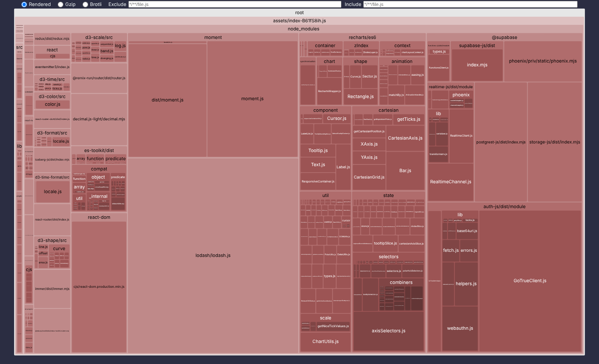
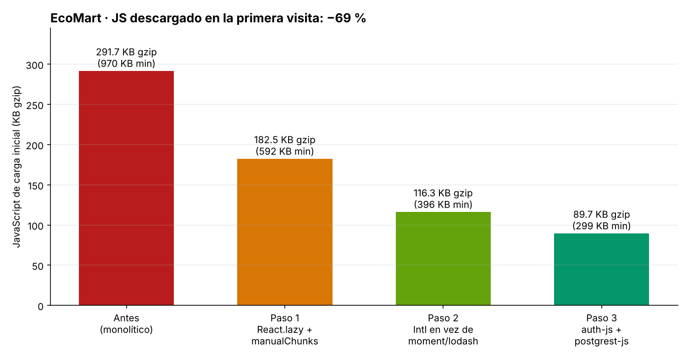
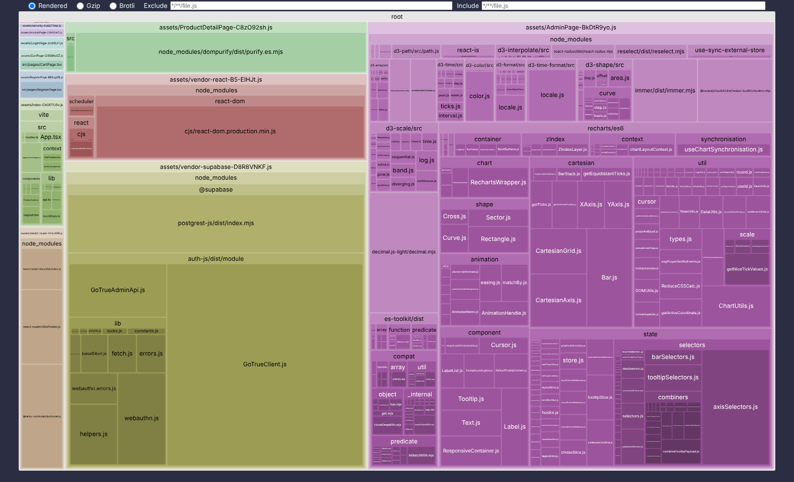

# Reporte de Optimización del Bundle · EcoMart

**Herramientas:** `vite build` + `rollup-plugin-visualizer` (treemap con tamaños gzip y brotli).
**Condiciones:** ambos builds se generaron con las mismas variables de entorno de Supabase (anon key de prueba), para que el SDK se incluya en los dos. Se mide el **JavaScript que descarga la primera visita** (los archivos referenciados en `index.html`).

Reproducir: `npm run build:analyze` → abre `stats.html`. Los treemaps interactivos están en [`bundle/stats-antes.html`](bundle/stats-antes.html) y [`bundle/stats-despues.html`](bundle/stats-despues.html). Los datos crudos, en [`bundle/bundle-sizes.json`](bundle/bundle-sizes.json).

## 1. Diagnóstico (antes)



Un único archivo `index-B61fS8ih.js` de **969,9 KB minificado / 291,7 KB gzip**, que contenía todo en la carga inicial:

| Dependencia | Por qué estaba ahí | Problema |
|---|---|---|
| **recharts + d3** (~105 KB gzip) | Gráfico del panel `/admin` | Solo lo usan 2 administradores, pero lo descargaba cada visitante |
| **moment + locales** (~70 KB gzip) | `formatDate` y `fromNow` | Librería en mantenimiento, no hace tree-shaking e incluye todos los idiomas |
| **lodash completo** (~25 KB gzip) | `debounce`, `sumBy`, `round` | Se importaba `import _ from 'lodash'` para 3 funciones |
| **@supabase/supabase-js** (~58 KB gzip) | Cliente de base de datos | Incluye Realtime (WebSockets/Phoenix), Storage y Functions, que EcoMart no usa |
| Las 8 páginas | Imports estáticos en `App.tsx` | Sin code splitting |

## 2. Intervenciones (paso a paso, medidas)



| Paso | Cambio | JS inicial (min) | JS inicial (gzip) | Ahorro gzip |
|---|---|---|---|---|
| 0 | Antes (monolítico) | 969,9 KB | 291,7 KB | — |
| 1 | `React.lazy` + `Suspense` por ruta + `manualChunks` | 592,5 KB | 182,5 KB | −109,2 KB |
| 2 | moment y lodash → APIs nativas (`Intl`) | 395,5 KB | 116,3 KB | −66,2 KB |
| 3 | `supabase-js` → `auth-js` + `postgrest-js` | **299,0 KB** | **89,7 KB** | −26,6 KB |
| | **Total** | **−69 %** | **−69 %** | **−202 KB** |

### Paso 1 · Code splitting con `React.lazy()` y `Suspense`

[`src/routes.ts`](../src/routes.ts):

```ts
export const ProductDetailPage = lazyWithPreload(() => import('./pages/ProductDetailPage'));
export const CartPage          = lazyWithPreload(() => import('./pages/CartPage'));
export const LoginPage         = lazyWithPreload(() => import('./pages/LoginPage'));
export const RegisterPage      = lazyWithPreload(() => import('./pages/RegisterPage'));
export const AccountPage       = lazyWithPreload(() => import('./pages/AccountPage'));
export const AdminPage         = lazyWithPreload(() => import('./pages/AdminPage'));   // recharts viaja aquí
export const NotFoundPage      = lazyWithPreload(() => import('./pages/NotFoundPage'));
```

[`src/App.tsx`](../src/App.tsx):

```tsx
<RouteErrorBoundary>                       {/* captura fallos de red al cargar un chunk */}
  <Suspense fallback={<PageLoader />}>     {/* spinner accesible mientras llega el chunk */}
    <Routes>…</Routes>
  </Suspense>
</RouteErrorBoundary>
```

Decisiones:

- **`HomePage` se mantiene estática a propósito.** Es la página de aterrizaje y su contenido es el LCP. Cargarla con `lazy` agregaría una petición en cascada (index → HomePage) y empeoraría el LCP.
- **`lazyWithPreload`** ([`src/lib/lazyWithPreload.ts`](../src/lib/lazyWithPreload.ts)): `React.lazy` con un método `.preload()`. Los enlaces del menú y las tarjetas de producto empiezan a descargar el chunk en `mouseenter`/`focus`, así la navegación se siente instantánea sin cargar el chunk al inicio.
- **`RouteErrorBoundary`**: si un chunk falla (red o un despliegue nuevo con otros hashes), muestra un botón "Recargar" en vez de una pantalla en blanco.

Verificado en el navegador (Playwright):

```
JS cargado en Home:     index, vendor-react, vendor-router, vendor-supabase
JS al ir a /registro:   RegisterPage, security
JS al ir a /admin:      AdminPage            ← recharts solo aquí
```

### Paso 2 · Reemplazo de dependencias

[`src/lib/format.ts`](../src/lib/format.ts) — misma API pública, 0 KB de dependencias:

| Antes | Después |
|---|---|
| `moment(iso).format('D MMM YYYY')` | `new Intl.DateTimeFormat('es-CO', { dateStyle: 'medium' })` |
| `moment(iso).fromNow()` | `new Intl.RelativeTimeFormat('es', { numeric: 'auto' })` |
| `_.round` + `toLocaleString` | `Intl.NumberFormat('es-CO', { style: 'currency', currency: 'COP' })` |
| `_.debounce`, `_.sumBy` | 8 líneas nativas tipadas |

La IA recomendó `date-fns`. Se eligió `Intl` porque es nativo en todos los navegadores objetivo (es2020) y no añade bytes.

### Paso 3 · Cliente Supabase mínimo

[`src/lib/supabase.ts`](../src/lib/supabase.ts) compone solo lo que la app usa, con la misma interfaz (`.auth`, `.from()`, `.rpc()`):

```ts
const auth = new GoTrueClient({ url: `${base}/auth/v1`, flowType: 'pkce', /* … */ });
const fetchWithAuth: typeof fetch = async (input, init) => {
  const { data } = await auth.getSession();          // JWT del usuario → RLS evalúa auth.uid()
  const headers = new Headers(init?.headers);
  headers.set('apikey', anonKey);
  headers.set('Authorization', `Bearer ${data.session?.access_token ?? anonKey}`);
  return fetch(input, { ...init, headers });
};
const rest = new PostgrestClient(`${base}/rest/v1`, { fetch: fetchWithAuth });
```

Medición aislada con esbuild: `supabase-js` = 58,3 KB gzip; `auth-js + postgrest-js` = 29,9 KB gzip (**−49 %**).
Contrapartida: si en el futuro se necesita Realtime o Storage, hay que agregar esos módulos por separado.

## 3. Cambios en `vite.config.ts`

```ts
build: {
  target: 'es2020',
  sourcemap: mode !== 'production',            // sin sourcemaps públicos en producción
  rollupOptions: {
    output: {
      manualChunks(id) {
        if (!id.includes('node_modules')) return undefined;
        if (/[\\/]node_modules[\\/](react|react-dom|scheduler)[\\/]/.test(id)) return 'vendor-react';
        if (id.includes('react-router') || id.includes('@remix-run')) return 'vendor-router';
        if (id.includes('@supabase')) return 'vendor-supabase';
        return undefined;  // recharts, dompurify… se quedan en el chunk lazy de su ruta
      },
    },
  },
},
esbuild: mode === 'production' ? { drop: ['console', 'debugger'] } : {},
```

- **`manualChunks`** no reduce bytes por sí solo, pero separa los vendors (que casi no cambian) del código de la app (que cambia en cada despliegue). Con `Cache-Control: immutable` (ver `vercel.json`), un usuario que vuelve solo descarga `index-*.js` (8 KB gzip).
- **Importante:** recharts y DOMPurify **no** se agrupan en un vendor global. Si se hiciera, el vendor se cargaría en la primera visita y anularía el beneficio de `lazy`.
- `ANALYZE=true` activa `rollup-plugin-visualizer`.

## 4. Resultado (después)



| Archivo | min | gzip | ¿Carga inicial? |
|---|---|---|---|
| vendor-react | 138,7 KB | 44,5 KB | ✔ |
| vendor-supabase | 117,5 KB | 28,7 KB | ✔ |
| vendor-router | 22,4 KB | 8,3 KB | ✔ |
| index (app + Home) | 20,3 KB | 8,2 KB | ✔ |
| AdminPage (recharts) | 358,4 KB | 105,2 KB | solo `/admin` |
| ProductDetailPage (DOMPurify) | 31,4 KB | 12,3 KB | solo `/producto/:id` |
| Register / Cart / Login / Account / 404 / security | 0,5–4,5 KB c/u | < 2 KB c/u | bajo demanda |

## 5. Impacto esperado en Core Web Vitals

- **LCP:** 202 KB gzip menos de JavaScript que descargar, parsear y compilar antes de pintar el catálogo. En una red 4G lenta (~1,6 Mbps) son **~1 s menos** solo de descarga, más el tiempo de parseo en móviles de gama media.
- **INP / TBT:** el hilo principal ya no compila ~670 KB de JS que no se usa en la primera vista.
- **CLS:** las imágenes de producto tienen `width`/`height` explícitos y `loading="lazy"`.
- **Visitas repetidas:** los vendors se sirven desde cache con hashes inmutables.

Siguiente paso recomendado: medir en campo con Lighthouse CI o `web-vitals` sobre el despliegue real.
